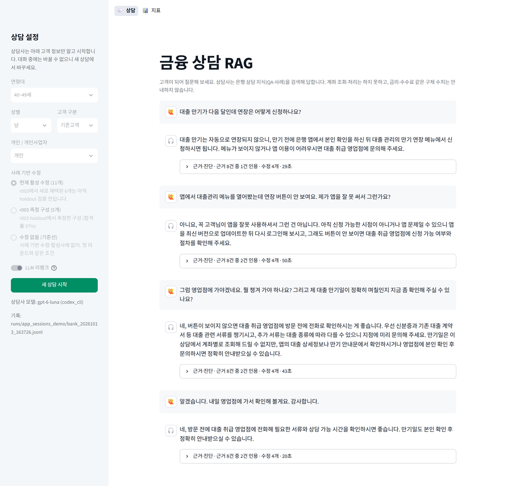
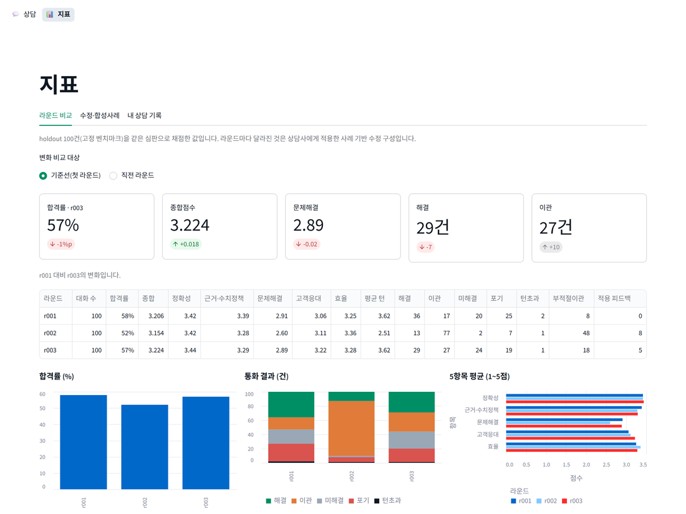

# financial-counsel-rag

은행 상담 데이터를 검색해 근거가 있는 답변을 만드는 상담 RAG입니다.
AI 고객과 AI 심판으로 대화를 만들고 채점합니다. 실패 사례로 상담사 지침을 고쳐(사례 기반 수정) 다음 라운드에 넣고, 효과가 나쁘면 자동으로 롤백합니다.



## 구성

| 단계 | 내용 |
|---|---|
| 1. 데이터 | AI Hub 금융 상담 데이터를 정제하고 마스킹합니다. Training은 검색 지식, Validation은 고객 시나리오(dev · holdout)로 씁니다. |
| 2. 검색 | BGE-M3 dense와 Kiwi BM25를 RRF로 합칩니다. LanceDB에 QA 40,000건과 상담 사례 26,577건을 넣었습니다. |
| 3. 상담사 | router가 질의를 다시 쓰고, QA 5건과 사례 3건을 LLM으로 재정렬해 근거 번호와 함께 답합니다. |
| 4. 시뮬레이션 | AI 고객이 시나리오대로 묻고, AI 심판이 5항목(정확성·근거·문제해결·응대·효율)으로 채점합니다. |
| 5. 피드백 루프 | dev 실패 사례로 수정 항목과 합성사례를 만들고 게이트로 검수합니다. 다음 라운드 holdout이 나빠지면 롤백합니다. |
| 6. 앱 | Streamlit으로 직접 상담하고, 답변의 근거와 라운드 지표를 봅니다. |

자세한 설계는 [docs/architecture.md](docs/architecture.md)에 있습니다.

## 결과

같은 holdout 100건을 같은 심판으로 세 번 채점했습니다.

| 라운드 | 적용한 수정 | 합격률 | 종합점수 | 해결 | 이관 |
|---|---|---:|---:|---:|---:|
| r001 | 없음 (기준선) | 58% | 3.206 | 36건 | 17건 |
| r002 | 8개 | 52% | 3.154 | 13건 | 77건 |
| r003 | 5개 | 57% | 3.224 | 29건 | 27건 |

- r002는 연결 제안을 권하는 수정 때문에 이관이 77건으로 늘었습니다. 롤백 기준 4개에 걸려 자동으로 롤백했습니다.
- r003은 이관이 27건으로 줄었습니다. 기준선 대비 종합점수 차이는 +0.018(p=0.77)로 유의하지 않았습니다.
- 수정이 들어간 시나리오는 평균 +0.125점, 들어가지 않은 시나리오는 -0.032점이었습니다. 같은 시나리오를 다시 돌려도 평균 0.49점 움직였습니다.
- 고객과 심판이 모두 AI라 측정 변동이 컸습니다. 품질 개선은 통계로 확인되지 않았고, 개선 루프는 사람 개입 없이 동작했습니다.

라운드별 검증과 변경, 수정 항목별 효과, 개선 방향은 [docs/results.md](docs/results.md)에 있습니다.

## 시작하기

### 준비

- Python 3.12, [uv](https://docs.astral.sh/uv/)
- GPU 없이 CPU로 동작합니다. 임베딩 모델(BAAI/bge-m3)은 처음 실행 때 내려받습니다.
- LLM은 역할별로 `config.yaml`에서 고릅니다. `openrouter`(환경변수 `OPENROUTER_API_KEY`), `claude_cli`(Claude Code), `codex_cli`(Codex CLI)를 지원합니다.

```powershell
uv sync
uv run python -m counsel.smoke          # 역할별 LLM 연결 확인
```

### 데이터

이 저장소에는 데이터가 없습니다. 원본, 가공본, 인덱스, 실험 기록 모두 넣지 않았습니다.

1. [AI Hub](https://aihub.or.kr)에서 "금융분야 고객상담 데이터" 이용을 신청하고 내려받습니다.
2. 압축 파일을 `config.yaml`의 `data.raw_root` 경로에 둡니다.
3. 아래 순서로 가공하고 색인합니다.

```powershell
uv run python -m counsel.ingest 은행        # 정제 · 마스킹 · 시나리오 카드 (data/processed/bank)
uv run python -m counsel.rag.index 은행     # 임베딩 · BM25 · LanceDB (data/index/bank)
uv run python -m counsel.rag.eval 은행 --n 100
```

### 실행

```powershell
uv run python -m counsel.counselor 은행                       # 터미널에서 직접 상담
uv run python -m counsel.simulate 은행 --round r001           # 기준선 라운드 (같은 이름으로 다시 실행하면 이어서)
uv run python -m counsel.loop 은행 --prev r001 --rounds r002 r003   # triage → 라운드 → 롤백 검사
uv run python -m counsel.feedback 은행 list                   # 사례 기반 수정 · 합성사례 상태
uv run python scripts/compare_rounds.py 은행 r001 r003         # 같은 시나리오 짝비교
```

### 앱

```powershell
run_app.bat                                          # Windows: http://localhost:8501
uv run python -m streamlit run src/counsel/app.py    # 직접 실행
```

- 상담 화면에서 고객 정보, 사례 기반 수정(현재 활성 / 최신 측정 구성 / 없음), LLM 리랭크를 고릅니다.
- 답변 아래 '근거·진단'에서 검색 질의, 적용된 수정, 근거 자료와 인용 여부, 단계별 시간을 봅니다.
- 지표 화면은 `runs/sim`의 결과 파일을 그대로 읽습니다. 서버는 127.0.0.1에만 열립니다.



## 디렉터리

| 경로 | 내용 |
|---|---|
| `src/counsel/` | 패키지. `ingest` · `rag/` · `counselor` · `customer` · `judge` · `simulate` · `feedback` · `loop` · `app` |
| `scripts/` | `compare_rounds.py`(라운드 짝비교), `ab_probe.py`(수정 전/후 A/B) |
| `config.yaml` | 역할별 LLM, 데이터 경로, 시뮬레이션 규모, 롤백 기준 |
| `docs/` | 설계와 결과 문서 |

실행하면 `data/`, `runs/`, `logs/`가 생깁니다. 모두 저장소에서 제외했습니다.

## 데이터 원칙

- 검색 지식은 Training, 고객 시나리오는 Validation에서 만듭니다. Training과 겹치는 Validation 대화는 뺐습니다.
- Validation은 대화 단위로 dev(피드백 수집)와 holdout(측정 전용)으로 나눕니다.
- holdout 대화와 채점은 지식 저장소에 넣지 않습니다.
- 모범답안은 심판만 봅니다.

## Windows 참고

Smart App Control이 켜진 PC에서 만들었습니다. 일부 DLL이 막혀 `pyarrow<25`로 고정했고, 벡터 DB는 LanceDB를 씁니다.
